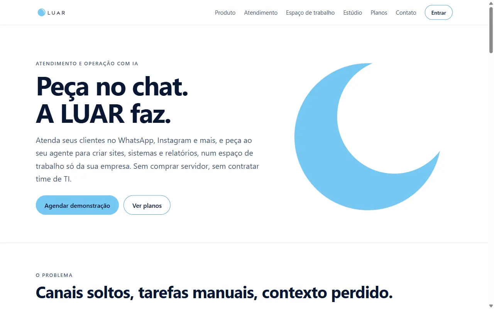

<!-- readme-padrao -->
# Site do LUAR

> Site institucional do LUAR.

## O que é
Site institucional do LUAR.

Estado: **no ar**.

## Onde está no ar
- https://luar.rangeltech.net

## Onde faz o deploy
Este repositório **só publica** o artefato (release com imagem e manifesto); **quem implanta é o `vps_rt_infra`**.

- Serviço `luar-site`: `gh workflow run deploy.yml --repo RangelTech/vps_rt_infra -f service=luar-site` (só validar: `-f dry_run=true`; voltar versão: `-f version=<tag-antiga>`)

Os `.env` desses serviços são gerados do Infisical no momento do deploy (spec 57, seção 0A).

## Como funciona por dentro
Resumo acima; os detalhes estão nas notas técnicas (README anterior) abaixo e na spec 57.

## Segredos
Nenhum valor de segredo fica neste repositório. Os segredos dos serviços ficam no Infisical (mapa em `vps_rt_infra/scripts/infisical/mapa_envs.json`) e chegam à VPS gerados no deploy.

## Rodar e testar localmente
Ver as notas técnicas abaixo (cada repositório tem o seu jeito); os testes de QA em produção são por cliques reais, com evidência em `new_ragente/qa/evidencias`.

## Links
- Repositório: https://github.com/RangelTech/luar_site
- Painel único: https://painel.rangeltech.net
- Spec de organização geral: `new_ragente/specs/57_ORGANIZACAO_GERAL_PRODUTOS_E_PAINEL.md`

## Notas técnicas (README anterior)

# luar_site

Site público do produto LUAR (`https://luar.rangeltech.net`): páginas do produto, páginas legais e versão em inglês. HTML estático servido por nginx sem privilégios (`Dockerfile`, `nginx.conf`).

- `public/`: o site publicado (início, atendimento, estúdio, espaço de trabalho, contato, cookies, exclusão de dados, `en/`).
- `content/pt` e `content/en`: textos legais em Markdown.
- `tools/build.py`: gera as páginas legais estáticas (`content/*.md` para `public/<rota>/index.html`) sem dependências. Rode `python tools/build.py` depois de editar um texto. `tools/site.py` monta o restante.

Versão: tag `v*` publica a imagem e o manifesto; o deploy é só pelo `vps_rt_infra` (`deploy.yml -f service=luar-site`).

Mapa geral do ecossistema: skill `ecossistema_rt` (repositório `personal-skills`).
